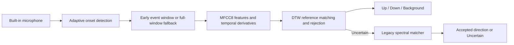

# Swipe

**Use the sound of a finger swipe on a MacBook speaker grille as an experimental input.**

Swipe listens through the built-in microphone and recognizes **Up** (toward the screen) and **Down** (toward the palm rest). It runs locally, includes a working reference model, and provides guided recording tools for further experiments. It uses the browser's mono microphone stream, not separate access to the MacBook's physical microphones.

Developed on the **left speaker grille of a 14-inch M3 Pro MacBook Pro**. Other people, laptops, microphone settings, and environments have not been validated. This is a research prototype; it displays gestures and does not trigger system actions.

## Quick start

Requirements: macOS for the intended hardware interaction, **Python 3.14** (the verified environment), and a browser with microphone access and AudioWorklet support, such as Chrome or Safari. Node.js is only needed for developer checks.

Clone the repository and install the local runtime:

```sh
git clone https://github.com/Twis06/swipe.git
cd swipe
python3.14 -m venv .venv
source .venv/bin/activate
python -m pip install -r requirements.txt
python -m swipe
```

Open **[localhost:8765/preview](http://localhost:8765/preview)** and keep the server running.

1. Allow microphone access and select the explicit **MacBook Pro Microphone / Built-in** device. Avoid the system-default alias and Bluetooth headsets. If names appear only after permission, select the built-in device and reconnect.
2. Click **Start preview** and keep still for one second while the onset detector settles.
3. Gently slide a finger along the left speaker grille. Up means toward the screen; down means toward the palm rest.
4. Make one swipe at a time, lift your finger to return, and wait for the result. Keep music off for the first trial.
5. **Stop listening** releases the microphone. Hiding or leaving the page also stops the preview.

The bundled model files are small and already included; no training or private recordings are required to try the preview. After setup, macOS users can also double-click `Start Swipe.command`.

## What is included

| Page | Purpose | Audio storage |
| --- | --- | --- |
| `/preview` | Live Up / Down / Uncertain results | Processed in memory; not saved |
| `/` | Guided two-second swipes, idle, and typing examples | WAV + JSON under `data/` |
| `/continuous` | Fifteen-second cued or free movement | WAV + prompt timeline under `data/` |

The recording-only server works with the Python standard library. The preview additionally needs NumPy and SciPy. The browser uses plain HTML/CSS/JavaScript; there is no frontend build step, npm dependency, or hosted inference service.

## Project layout

```text
swipe/              Python application and recognition code
web/                Browser pages, styles, scripts, and active audio worklets
models/             Bundled reference banks and integrity manifests
research/           Offline experiments, replay tools, and prototype worklets
tests/              Python regressions and JavaScript capture/client tests
scripts/            Portable test and release-check commands
docs/               Model card, recording guide, design notes, and evaluation reports
```

Run commands from the checkout root. Local `data/`, `diagnostics/`, and `checkpoints/` folders hold recordings, generated experiments, and saved baselines; Git excludes them. Published evidence lives under `docs/evaluation/`, separate from generated outputs. The app uses `python -m swipe`; it does not need an editable install or a `PYTHONPATH` setting.

## How recognition works



The main matcher compares 32-frame feature sequences against 60 reference swipes from three recording sessions. It uses eight cepstral coefficients plus their temporal derivatives, three-neighbor DTW matching, and rejection thresholds. When it is uncertain, the previous spectral matcher may rescue the result. Background gating and duplicate suppression prevent some unwanted activations. Scores are not calibrated probabilities.

## Current evidence

These are **exploratory results on reused development recordings**, with each query session excluded from its direction references. They are not a fresh accuracy estimate for a new person or laptop.

| Reference-excluded check | Previous matcher | Current MFCC8 + fallback |
| --- | ---: | ---: |
| Correct accepted swipes / 60 | 37 | **49** |
| Wrong accepted swipes / 60 | 1 | **1** |
| Rejected swipes / 60 | 22 | **10** |
| Background activations / 24 | 0 | **0** |
| Median inference time | 6.77 ms | **7.01 ms** |

Inference timing excludes audio capture, decoding, HTTP, and display. In a separate stateful replay, recorded-background lead-in gave a median signal-clock display delay of about 332 ms, with a roughly 1-second p95. That replay includes reference examples and excludes compute/network delays; it is integration evidence, not independent accuracy or end-to-end latency.

See the [model card](docs/MODEL_CARD.md) for calibration, failure modes, provenance, and links to the saved evidence. Raw recordings and local checkpoints are deliberately excluded from the public repository.

## Collecting data and contributing

See [recording instructions](docs/RECORDING.md) for the pilot and continuous workflows. Collecting clips does **not** automatically update the preview model. Research scripts in `research/` and historical dataset-dependent tests in `tests/` remain available, but their original private dataset and intermediate caches are not distributed.

Run the portable checks with Python dependencies installed and **Node.js 22+** available:

```sh
python scripts/check.py
python scripts/check_release.py
```

These checks use synthetic audio and the bundled models; they do not access the microphone or retrain the model. The first command checks capture, decoding, matching, rejection, request handling, and client lifecycle behavior. The second inspects the Git publication file set for excluded artifacts and verifies model integrity. CI runs both on macOS and Linux; Linux checks do not validate MacBook microphone behavior.

See [CONTRIBUTING.md](CONTRIBUTING.md) for the code map, research dependencies, and model-change requirements.

## Troubleshooting

- **Microphone missing or silent:** allow browser microphone permission in macOS settings, then reload and explicitly choose the built-in input. The guided collector blocks headset and default-alias devices.
- **Frequent Uncertain results:** check the microphone and swipe location, keep music off, and try isolated swipes at a natural pace. The bundled bank may not transfer to your setup.
- **High input peaks:** Float32 audio can exceed ±1 without encoder clipping. A red possible-clipping warning differs from an amber high-level notice; see the recording guide.
- **Preview unavailable:** run the server with the virtual environment's Python and install `requirements.txt`. A checksum failure means the model or inference code differs from its manifest; restore a matching version rather than bypassing verification.
- **Port already in use:** stop the previous server, or use `python -m swipe --port 8766` and open that port instead.

## Privacy and license

Audio goes from the browser to a server bound to `127.0.0.1`. The app does not send it to an external service. Recorders write files locally; live prediction does not. Cloud-sync or backup software may separately upload files if you place the project in a synced folder. See [SECURITY.md](SECURITY.md) for the local-only scope.

[MIT](LICENSE), including the bundled project-owned reference model artifacts. Dependencies retain their own licenses.
